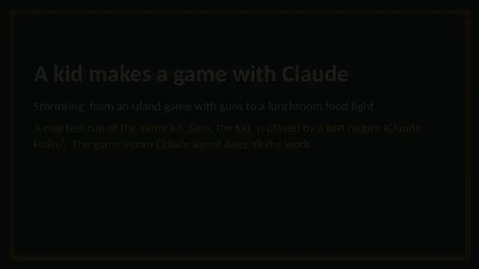

# Game Kit

Make your own video game with Claude, from the first idea to a game your friends play on the web, on Android, and on Windows or Linux.

The kit is made for a 16-year-old with no coding background. **You** make every choice. Claude writes the code, and it builds only what you understand: it shows a plan, asks you 1–3 questions, and gives hints, never the answers.

- **Engine:** [Godot 4.7.2](https://godotengine.org) (free)
- **AI helper:** Claude Code
- **Builds and hosting:** GitHub (free): web, Android, Windows, Linux
- **Online:** GD-Sync rooms with a 4-digit code, up to 4 players (free)

## See it work (90 seconds)



With sound: [download the video with narration (MP4, 7 MB)](docs/media/stormring-kid-and-claude.mp4)

A real test run of the kit. The kid asks for a change to the example game Stormring: "no guns, a food fight in a giant school lunchroom". You see:
1. The kid says the idea. Claude splits it into small steps.
2. Claude asks questions about the plan. A wrong answer gets a hint, not the answer.
3. Nothing changes until the kid says yes. Then Claude builds one step, and the kid plays it.
4. Claude reads its own test run and finds a bug (the bots splat you in 2 seconds).
5. The finished Lunchroom Food Fight. The maintainer finished it later with the same kit.

In this test, a second AI (Claude Haiku) plays the kid. The game's own Claude does all the work, the same way as for a real kid.

## Start here

| Who | Read |
|---|---|
| **Parent** | [PARENTS.md](PARENTS.md): what your kid does and learns, safety, cost, and your 10 minutes a week. No tech needed. |
| **Setup adult + kid** | [docs/1-setup.md](docs/1-setup.md): the one-time setup (about 4 hours). For an adult who is comfortable with computers. |
| **Kid** | [docs/2-godot-basics.md](docs/2-godot-basics.md): what Godot is, how a game is built, and how to use the editor |
| **Kid** | [docs/3-make-the-game.md](docs/3-make-the-game.md): how you work with Claude, then your first game |
| **Kid** | [docs/4-make-it-better.md](docs/4-make-it-better.md): tune the feel, new ideas, art and sound |
| **Kid** | [docs/5-ship-and-play.md](docs/5-ship-and-play.md): release a version, the 4 platforms, online rooms |
| **Kid** | [docs/6-friends-and-feedback.md](docs/6-friends-and-feedback.md): bug reports and ideas from friends, and the docs for your players |
| **Kid** | [docs/7-when-stuck.md](docs/7-when-stuck.md): common problems and what to do |

## Keep your chats out of AI training

Claude Pro is on an adult's account. If its training setting is on, Anthropic may use its chats and Claude Code sessions to train new AI models. Make sure that it is off before the first session:

1. Sign in at claude.ai with the account Claude Code uses.
2. Open [claude.ai/settings/data-privacy-controls](https://claude.ai/settings/data-privacy-controls) (your name → **Settings** → **Privacy**).
3. Turn off the switch that lets Anthropic use your chats to improve its AI models.

With the switch off:
- New chats are not used for training.
- Anthropic keeps them for 30 days, not 5 years.

The switch covers Claude Code too. The kit does the rest: [starter/.claude/settings.json](starter/.claude/settings.json) turns off `/feedback`, `/bug`, `/share`, and the session survey. Those would send the chat and code to Anthropic, kept for 5 years.

More: [Claude Code data usage](https://code.claude.com/docs/en/data-usage) and [how to change the setting](https://privacy.claude.com/en/articles/12109829-how-do-i-change-my-model-improvement-privacy-settings).

## What is in this repo

```
game-kit/
├── README.md       This page
├── PARENTS.md      For parents (no tech needed)
├── docs/           The guides, in order
├── starter/        The files for a new game repo: Claude's rules and skills, the build pipeline, an empty Godot project
└── examples/       Two games made with this kit
```

- **[starter/](starter/)**: copy everything in it into your new game repo ([docs/1-setup.md](docs/1-setup.md), part C). Then open the folder in Claude Code and say `What do we do first?`. The list of what to say to Claude is in [starter/SKILLS.md](starter/SKILLS.md).
- **[examples/](examples/)**: [Stormring](https://github.com/acetousk/stormring) (3D, online food fight) and [Lantern Deep](https://github.com/acetousk/lantern-deep) (2D, turn-based cave crawler).

## The rules Claude follows

1. You say what you want. Claude says if it is possible, and how it works.
2. Claude shows a plan and asks you 1–3 questions. Wrong? A hint, never the answer. After 3 hints, you ask Claude a question.
3. Nothing changes until you get them right and say yes.
4. Claude does one small step. You press F5 and play.
5. Nothing ships until you can explain what is new.

Claude cannot change these rules, ask for passwords or keys, make you type commands, add chat, or copy another game.
